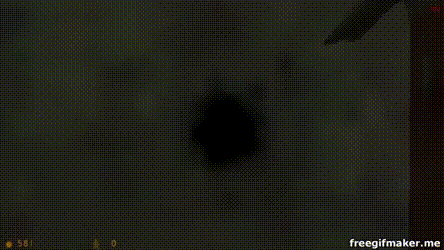

<div align="center">



# Crowbar ⚡
*Next-Generation Data Transformation, Structure-Preserving Mutation & Evolutionary Testing Framework for Crystal*

[](https://github.com/sol-vin/crowbar/actions/workflows/ci.yml)
[](https://crystal-lang.org)
[](LICENSE)
[](https://sol-vin.github.io/crowbar/)

*Pure Crystal. Zero external C/binary dependencies. Native Windows, Linux, and macOS support.*

</div>

---

## Overview

**Crowbar** is a modern, extensible data transformation, structure-preserving mutation, and feedback-driven test generation engine for [Crystal](https://crystal-lang.org).

Inspired by the versatility of general-purpose mutation engines and modern property-based testing, Crowbar operates both as a **high-throughput UNIX streaming filter** (`cat input | crowbar > output`) and a **deeply customizable, type-safe Crystal DSL**.

### Key Features

- 🧬 **Feedback-Driven Evolutionary Search (Genetic Algorithm)**: Callers can report execution outcomes (`fuzzer.report(candidate, fitness, feature, coverage_hash)`) back to the engine. Uses tournament/roulette selection, crossover recombination, and anti-stagnation novelty injection.
- 🎰 **Multi-Armed Bandit (UCB1 Credit Assignment)**: Dynamically rewards mutators and scopes that achieve fitness breakthroughs or uncover new execution states, automatically balancing exploitation with exploration.
- 🗃️ **Multi-Feature Coverage Bucketing & Novelty Search**: Retains candidates that uncover distinct parser error codes or branch coverage hashes, preventing novel behaviors from being pruned by 1D scalar ranking.
- 🔤 **Dynamic Vocabulary Harvesting**: Ingests keywords, tokens, and identifiers extracted from target error messages via `fuzzer.harvest(error_text)` into the active mutation dictionary.
- 📦 **Declarative Protocol Framing (`frame` & `field`)**: Model binary protocol packets declaratively with automatic payload length recalculation (`relates_to: :payload`) and checksum recalculation (`covers: [...]`, e.g. IEEE 802.3 CRC32).
- 📜 **Context-Free Generative Grammars (`grammar`)**: Generate structured starting seeds (SQL statements, expressions, commands) using weighted production rules with bounded recursion depth.
- 📐 **Structure-Preserving Rules (24 Formats)**:
  - **`JSON`**: Mutates AST leaf nodes (numbers, strings, booleans, arrays, keys) while guaranteeing 100% syntactically valid JSON output.
  - **`YAML`**: Transforms scalar values and mappings while preserving document hierarchy and indentation.
  - **`HTTP`**: Mutates headers, query strings, and body payloads while maintaining strict RFC 7230 CRLF framing.
  - **`DNS`**: Wire-format DNS packet mutations (RFC 1035) preserving 12-byte headers and length-prefixed domain labels.
  - **`CSV`**: Tabular record mutations, column swapping/dropping, quote boundaries, and ragged row injection.
  - **`XML`**: AST-level XML/HTML tree manipulation, attribute fuzzing, and CDATA wrapping.
  - **`URL`**: RFC 3986 URI/URL path traversal, query parameter pollution, and port boundaries.
  - **`TLV`**: Type-Length-Value frames with length under/over-reporting and tag corruption.
  - **`Base64`**: Transparent decode-mutate-encode Base64 envelope transformations.
  - **`Varint`**: LEB128/Protobuf 7-bit continuation bit integer stream boundaries.
  - **`FTP`**: RFC 959 command and response streams with CRLF framing, mutating commands (USER, PORT, RETR) and response codes.
  - **`SQL`**: Structure-preserving SQL statements fuzzing numerics, string literals, clauses, and operators while maintaining parser validity.
  - **`PNG`**: 8-byte file signature preservation, chunk framing (`IHDR`, `IDAT`, `IEND`), and automated chunk length and CRC32 checksum recalculation.
  - **`BMP`**: Windows Bitmap preserving 14-byte file header (`BM`) and DIB header, mutating dimensions, bit depths, compression, and pixel rasters.
  - **`WAV`**: RIFF/WAVE container preservation, `fmt ` subchunk parameter fuzzing (sample rates, channels, bit depths), and PCM waveform mutation.
  - **`MP3`**: MPEG Layer III preservation of ID3v2 tags and 11-bit MPEG audio frame sync words (`0xFF 0xE0+`), mutating bitrates, sample frequencies, and audio payloads.
  - **`WAD`**: id Software Doom IWAD/PWAD file container, preserving 12-byte header, 16-byte lump directory table entries, and structured payloads (`THINGS`, `VERTEXES`, `LINEDEFS`, sound/graphics).
  - **`PDF`**: Adobe Portable Document Format, preserving indirect object framing (`obj ... endobj`), mutating dictionary attributes and stream bodies, with automated `startxref` offset synchronization.
  - **`7Z`**: 7-Zip archive framing with automated StartHeader CRC32 recalculation.
  - **`TAR`**: POSIX UStar TAR archive framing with automated octal checksum recalculation.
  - **`ZIP`**: PKZip archive framing with automated chunk length and CRC32 checksum recalculation.
  - **`PACKET`**: Raw IPv4, TCP, UDP, and PCAP packet framing with automated checksum recalculation.
  - **`MARKDOWN`**: CommonMark document AST with link, table, heading, and code fence mutations.
  - **`JWT`**: RFC 7519 JSON Web Tokens with algorithm confusion (`none`, `HS256`), claim boundary testing (`exp`, `iat`, `nbf`), `kid` injection, role escalation, and signature tampering.
- 🎯 **Fine-Grained Selectors & Combinators**: Target byte ranges (`scope :header, bytes: 0...16`), columns (`field: 1`), character classes (`chars: :digits`), periodic strides (`stride: 4`), Shannon entropy (`entropy: :high`), or combine with `&`, `|`, and `~`.
- 🔧 **Post-Transform Fixup Hooks**: Automatically recalculate checksums (CRC32, MD5) or payload length fields after mutating body contents.
- 🎲 **Deterministic PRNG (Xoshiro256++)**: Fast 64-bit random state seeded for exact, reproducible test cases across platforms.
- 🎨 **Opal TrueColor Hex Diff & CLI**: Side-by-side terminal hex diff visualization powered by [Opal](https://github.com/sol-vin/opal).
- 📦 **Automated Versioning & Docs**: Integrated with [Carbon](https://github.com/sol-vin/carbon) for monotonic commit versioning and [Jasper](https://github.com/sol-vin/jasper) for multi-track documentation guides.

---

## Installation

Add Crowbar to your `shard.yml`:

```yaml
dependencies:
  crowbar:
    github: sol-vin/crowbar
    branch: master
```

Then run:

```bash
shards install
```

---

## Quick Start (CLI)

Build the standalone `crowbar` binary:

```bash
shards build crowbar
```

### 1. Pipe-In, Pipe-Out (UNIX Filter Mode)

```bash
# Transform data flowing through a pipe while preserving JSON syntax
echo '{"user": "alice", "age": 30, "admin": false}' | bin/crowbar --rule json -s 42
```

**Output:**
```json
{"user":"32767","age":30,"admin":false}
```

### 2. Opal TrueColor Hex Diff

```bash
# Visually inspect byte-level differences directly in your terminal
echo '{"hello": "world"}' | bin/crowbar --diff --seed 42
```

**Output:**
```text
=== Crowbar Hex Diff ===
Original Size: 19 B | Mutated Size: 29 B
----------------------------------------------------------------
00000000: 7B 22 68 34 32 39 34 39  36 37 32 39 35 65 6C 6C  |{"h4294967295ell|
00000010: 6F 22 3A 20 22 77 6F 72  6C 64 22 7D 0A           |o": "world"}.   |
----------------------------------------------------------------
```

### 3. Batch Test Case Generation

```bash
# Generate 100 deterministic test files from sample inputs
bin/crowbar -n 100 -s 1337 -o "fuzz-%n.bin" samples/*.bin
```

### 4. Component Catalog

```bash
bin/crowbar --list
```

**Output:**
```text
=== Crowbar Component Catalog ===

Structure-Preserving Rules (24 Formats):
  json       Valid JSON AST with mutated leaf values and bounds
  yaml       Valid YAML document hierarchy with mutated scalars
  http       RFC HTTP/1.x framing with mutated headers, paths, or body
  dns        RFC 1035 wire-format DNS packets with mutated records
  csv        RFC 4180 CSV/TSV tabular data with column and cell transforms
  xml        Valid XML/HTML document tree with mutated nodes and attributes
  url        RFC 3986 URI/URL and query string parameters
  tlv        Type-Length-Value binary packet framing and boundary lengths
  base64     Transparent Base64 envelope decode-mutate-encode
  varint     LEB128/Protobuf 7-bit continuation bit integer streams
  ftp        RFC 959 FTP command and response streams with CRLF framing
  sql        Structure-preserving SQL statement with mutated literals & operators
  png        Portable Network Graphics with automatic chunk framing & CRC32 recalculation
  bmp        Windows Bitmap (BMP) with header dimensions, compression & pixel rasters
  wav        RIFF/WAVE audio streams with fmt parameters, channels & PCM samples
  mp3        MPEG Layer III audio with ID3v2 tags and synchronized frame headers
  wad        Doom IWAD/PWAD packages with lump directory preservation & struct fuzzing
  pdf        Portable Document Format with object framing & startxref synchronization
  7z         7-Zip archive framing with automated StartHeader CRC32 fixup
  tar        POSIX UStar TAR archive framing with automated octal checksum fixup
  zip        PKZip archive framing with automated length and CRC32 fixup
  packet     Raw IPv4, TCP, UDP, and PCAP framing with RFC checksum fixups
  markdown   CommonMark/Markdown documents with link, table, heading & fence mutations
  jwt        JSON Web Token (RFC 7519) with algorithm confusion, claim boundary, and signature tampering

Mutation Patterns:
  od, once   - Mutate once at a single target
  nd, many   - Mutate multiple times with geometric probability decay (default)
  bu, burst  - Mutate in localized burst clusters
```

### 5. Stateful Sessions & Evolutionary Feedback Loops (`crowbar session`)

When fuzzing complex parsers, feedback loops allow Crowbar to track running memory of actions, successes, and failures using its **Multi-Armed Bandit (UCB1)** and **Genetic Corpus**. The `crowbar session` command enables persistent, stateful iterative workflows across CLI invocations without socket connections or background daemons.

#### Initializing a Session & Auto-Detection
Pipe an initial baseline file or text into `crowbar session <id> next`. Crowbar automatically detects magic bytes (such as Doom WAD, PDF, MP3 frame sync, PNG signatures, RIFF/WAVE, BMP, HTTP, FTP, or SQL) and attaches the appropriate format rule:

```bash
# Pipe an MP3 file into a session (auto-detects MP3 frame sync & ID3 rules)
cat song.mp3 | crowbar session audio next > mutant_01.mp3

# Or pipe an HTTP request
echo -e "POST /api/upload HTTP/1.1\r\nContent-Type: application/json\r\n\r\n{\"key\":\"val\"}" | crowbar session 1 next > out.txt
```

#### Generating Subsequent Mutants
Once initialized, generate new mutants directly from stored session memory:

```bash
crowbar session audio next > mutant_02.mp3
```

#### Providing Feedback (Rewards)
Reward or penalize the mutators that produced the previous mutant:

```bash
# Positive feedback (0.0 to 1.0): rewards mutator arms and saves candidate to corpus
crowbar session audio reward 0.8

# Negative feedback (-1.0 to 0.0): penalizes mutators and prunes candidate
crowbar session audio reward -0.5
```

#### Dynamic Session Configuration (`crowbar session <id> setup`)
Inspect or customize the active rules, mutator pools, patterns, and target scopes for a session:

```bash
# View active session configuration
crowbar session audio setup

# Add or remove format rules
crowbar session audio setup --add-rule mp3
crowbar session audio setup --auto-rule

# Filter mutator arsenal
crowbar session audio setup --set-mutators num,bf,wd -p burst
crowbar session audio setup --add-mutator sr

# Define targeted scopes within the session
crowbar session audio setup --add-scope head --selector header --params length:32
crowbar session audio setup --add-scope payload --selector footer --params length:64
```

#### Checking Status & Listing Sessions

```bash
# Detailed session metrics, bandit pulls, and top mutators
crowbar session audio status

# List all active sessions
crowbar session list
```

#### Resetting a Session

```bash
# Explicitly reset and delete session state
crowbar session audio reset

# Automatic reset: piping a new/different baseline into an existing session ID
cat new_sample.mp3 | crowbar session audio next > mutant_01.mp3
```

#### Complete Fuzzing Loop Example (Shell / CI Harness)

```bash
#!/bin/bash
# Initialize session with seed file
cat seed.mp3 | crowbar session fuzzer next > current.mp3

for i in $(seq 1 100); do
  # Run target parser on the current mutant (zero network sockets touched)
  ./target_decoder current.mp3 > decoder.log 2>&1
  EXIT_CODE=$?

  if [ $EXIT_CODE -eq 139 ]; then
    echo "[!] CRASH DETECTED on iteration $i!"
    cp current.mp3 "crash_$i.mp3"
    crowbar session fuzzer reward 1.0
  elif grep -q "syntax error" decoder.log; then
    crowbar session fuzzer reward -0.2
  else
    crowbar session fuzzer reward 0.4
  fi

  # Generate next mutant for the next iteration
  crowbar session fuzzer next > current.mp3
done
```

### 6. Diagnostic Inspection & Shannon Entropy Profiling (`crowbar inspect`)

Inspect arbitrary input files or streams to examine format boundaries, chunk framing, and block-level Shannon entropy distribution:

```bash
# Inspect a structured document or binary
bin/crowbar inspect sample.png

# Or emit machine-readable JSON metrics for CI pipelines
bin/crowbar inspect payload.jwt --json
```

**Terminal Output Example:**
```text
=== Crowbar Diagnostic Inspector ===
Target: sample.png | Size: 1,024 B | Format: PNG
Magic Bytes: 89 50 4E 47 0D 0A 1A 0A
------------------------------------------------------------------------------
Structural Format Boundaries:
  [0x0000 - 0x0007]  Signature            PNG 8-byte file signature [OK]
  [0x0008 - 0x0020]  Chunk: IHDR          13 B payload, CRC: 0x4D3A12F0 [OK]
  [0x0021 - 0x03E0]  Chunk: IDAT          959 B payload, CRC: 0xA911B321 [OK]
  [0x03E1 - 0x03FF]  Chunk: IEND          0 B payload, CRC: 0xAE426082 [OK]
------------------------------------------------------------------------------
Shannon Entropy Distribution:
  Block  Offset Range     Entropy   Profile             Density Bar
   00    0x0000 - 0x003F    3.42    [Structured/Text]   ██████░░░░░░░░░░ 3.42
   01    0x0040 - 0x007F    7.91    [Compressed/Random] ████████████████ 7.91
   ...
------------------------------------------------------------------------------
Overall Shannon Entropy: 7.41 bits/byte (High Density / Compressed / Encrypted)
```

### 7. Anomaly-Preserving Test Case Minimization (`crowbar shrink`)

When fuzzing uncovers crashes or failures in large inputs (e.g. 10KB+ payloads), `crowbar shrink` executes a hierarchical delta-debugging ($DDMIN$) algorithm that reduces the bloated reproducer down to its absolute minimal form:

```bash
# Minimize crash reproducer using target command as predicate
bin/crowbar shrink crash.bin --cmd "./target_parser @@" -o crash.min

# Or match specific failure strings in stdout/stderr
bin/crowbar shrink crash.bin --cmd "./target_parser @@" --match "SIGSEGV" -o crash.min
```

> **Syntax Anomaly Preservation**: Unlike aggressive AST normalizers that deduplicate keys or alter casing, `crowbar shrink` operates via pure raw delta debugging. It strictly preserves security-critical anomalies such as **duplicate keys** (e.g., `{"role": "user", "role": "admin"}`), parser differential bugs, and broken protocol framing!

### 8. Session Mutation Heatmaps & Shrinking

Audit session mutation coverage or minimize past mutants directly from session storage:

```bash
# Render session mutation heatmap showing hit frequency per byte offset
crowbar session audio inspect

# Minimize the mutant generated in iteration #42
crowbar session audio shrink 42 --cmd "./target_parser @@" -o repro_42.min
```

### 9. Automated Mutation Fuzzing Campaigns (`crowbar campaign`)

Execute high-throughput, multi-target mutation fuzzing campaigns across built-in parsers or custom protocol targets:

```bash
# Run a quick 200-iteration campaign across all standard battery targets
bin/crowbar campaign --iterations 200

# Target specific endpoints (e.g. JSON and JWT parsers)
bin/crowbar campaign --target json,jwt --iterations 500

# Generate artifacts for CI pipelines (Markdown summary, JSON metrics, and reproducers)
bin/crowbar campaign -n 1000 --markdown artifacts/fuzz-report.md --json artifacts/fuzz-report.json --output-dir artifacts/fuzz
```

**Two-Tier Declarative DSL Integration:**

```crystal
require "crowbar"

# Construct and run an automated campaign with bounded execution timeouts and watchdog invariants
report = Crowbar.campaign("Nightly Security Hardening") do |c|
  c.iterations 500
  c.seed 42_u64
  c.watchdog 10.seconds # 60-second watchdog compliance
  c.auto_shrink true    # automatically delta-minimize any failing crash reproducers

  # Define targeted fuzzing endpoints
  c.target "json_endpoint", category: :serialization do |t|
    t.sample %({"user": "admin", "permissions": ["read", "write"]})
    t.rule :json
    t.expected_errors JSON::ParseException, ArgumentError
    t.timeout 250.milliseconds
    t.execute do |buf|
      JSON.parse(buf.to_s)
    end
  end

  # Or load the full standard battery (JSON, YAML, JWT, HTTP, CSV, URI, Base64, Packet)
  c.include_default_targets!
end

puts report.to_markdown
```

### 10. Nightly CI/CD Mutation Fuzzing Workflow

Crowbar includes a dedicated GitHub Actions workflow (`.github/workflows/nightly-fuzz.yml`) that runs every night at `03:00 UTC` and supports manual triggers via `workflow_dispatch`. It runs across Linux and Windows, executes high-throughput mutation campaigns, verifies that zero unhandled crashes or infinite loops occur, minimizes reproducers automatically, and uploads detailed test reports and artifacts.

---

## Quick Start (Crystal DSL)

### 1. Zero-Config Black-Box Transformation

```crystal
require "crowbar"

sample = "The quick brown fox jumps over the lazy dog 12345"
mutant = Crowbar.fuzz(sample, seed: 42_u64)
puts mutant
```

**Output:**
```text
The quick brown fox jumps 4294967295over the lazy dog 12345
```

### 2. Structured Protocol Framing & Length Fixups

```crystal
require "crowbar"

# Modernized protocol fuzzer: 16-byte binary header + JSON body
fuzzer = Crowbar.define do
  seed 42_u64

  # Use multi-pass burst pattern
  pattern :burst

  # Preserve valid JSON structure in body
  scope :body, bytes: 16.. do
    preserve :json
  end

  # Post-mutation fixup hook: automatically recompute payload length!
  fixup do |buffer|
    next if buffer.size < 16
    payload_len = (buffer.size - 16).to_u32
    IO::ByteFormat::BigEndian.encode(payload_len, buffer[0, 4])
  end
end

header = Bytes.new(16, 0_u8)
json_payload = %({"status": "active", "code": 200, "meta": {"debug": false}}).to_slice
packet = IO::Memory.new
packet.write(header)
packet.write(json_payload)

mutant = fuzzer.fuzz(packet.to_slice)
```

**Output:**
```text
[1] Total: 68 B | Header Len: 52 B | Actual Body: 52 B
    Body JSON: {"status":"32767","code":200,"meta":{"debug":false}}
[2] Total: 63 B | Header Len: 47 B | Actual Body: 47 B
    Body JSON: {"status":"","code":200,"meta":{"debug":false}}
[3] Total: 89 B | Header Len: 73 B | Actual Body: 73 B
    Body JSON: {"status":"active","code":200,"meta":{"debug":false,"debug_extra":false}}
[4] Total: 58 B | Header Len: 42 B | Actual Body: 42 B
    Body JSON: {"status":"active","meta":{"debug":false}}
[5] Total: 86 B | Header Len: 70 B | Actual Body: 70 B
    Body JSON: {"status":"active","code":200,"meta":{"debug":false},"code_extra":200}
```

### 3. Feedback-Driven Evolutionary Optimization

```crystal
require "crowbar"

fuzzer = Crowbar.define do
  seed 42_u64

  evolution do
    enabled true
    population_size 64
    selection :tournament, size: 4
    crossover_rate 0.25
    exploration_rate 0.15 # 15% random exploration to prevent local loops
    stagnation_limit 100  # Inject fresh entropy after 100 stagnant cycles
  end
end

baseline = "SELECT id, name FROM users WHERE age > 18"

100.times do
  candidate = fuzzer.fuzz(baseline)

  # Evaluate candidate with your target program or parser
  fitness = evaluate_target_coverage(candidate)

  # Report feedback to guide subsequent generations
  fuzzer.report(candidate, fitness: fitness)
end
```

### 4. Declarative Binary Protocol Framing & Auto-Checksums

```crystal
require "crowbar"

# Declaratively define a binary packet structure:
# Automatically recalculates payload length and IEEE 802.3 CRC32 whenever payload mutates!
fuzzer = Crowbar.define do
  seed 1337_u64

  frame :sensor_packet do
    field :magic, default: Bytes[0xAA, 0x55], mutate: false
    field :version, kind: :u8, default: 1_u8, mutate: false
    field :length, kind: :u16_be, relates_to: :payload
    field :payload, default: "TEMP=24.5C;PRESSURE=1013HPA"
    field :checksum, kind: :crc32
  end
end

mutant = fuzzer.fuzz_frame(:sensor_packet)
```

### 5. Context-Free Generative Grammar

```crystal
require "crowbar"

# Generate structured, syntactically valid starting seeds with bounded recursion:
fuzzer = Crowbar.define do
  seed 42_u64

  grammar :query, max_depth: 4 do
    rule :start, ["SELECT ", :cols, " FROM ", :table]
    rule :cols, ["*"], weight: 0.2
    rule :cols, [:col, ", ", :cols], weight: 0.8
    choices :col, ["id", "username", "email", "balance"]
    choices :table, ["users", "accounts", "orders"]
  end
end

seed_sql = fuzzer.generate(:query)
puts seed_sql # => SELECT id, balance, * FROM users
```

---

## Practical Runnable Examples

The repository includes runnable, documented example programs under [`examples/`](examples) showcasing real-world testing workflows:

### 1. Structured JSON Protocol Fuzzer (`examples/json_protocol_fuzzer.cr`)
Fuzzes a compound packet featuring a 16-byte binary header followed by a JSON payload. Employs `preserve :json` within a scoped byte range to guarantee valid JSON syntax while mutating AST nodes, paired with a `fixup` hook that updates the 4-byte big-endian header length field.

```bash
crystal run examples/json_protocol_fuzzer.cr
```

**Output:**
```text
=== Original Packet (75 bytes) ===
Bytes[0, 0, 0, 0, 0, 0, 0, 0, 0, 0, 0, 0, 0, 0, 0, 0, 123, 34, 115, 116, 97, 116, 117, 115, 34, 58, 32, 34, 97, 99, 116, 105, 118, 101, 34, 44, 32, 34, 99, 111, 100, 101, 34, 58, 32, 50, 48, 48, 44, 32, 34, 109, 101, 116, 97, 34, 58, 32, 123, 34, 100, 101, 98, 117, 103, 34, 58, 32, 102, 97, 108, 115, 101, 125, 125]

=== Generating 5 Mutated Packets ===
[1] Total: 68 B | Header Len: 52 B | Actual Body: 52 B
    Body JSON: {"status":"32767","code":200,"meta":{"debug":false}}
[2] Total: 63 B | Header Len: 47 B | Actual Body: 47 B
    Body JSON: {"status":"","code":200,"meta":{"debug":false}}
[3] Total: 89 B | Header Len: 73 B | Actual Body: 73 B
    Body JSON: {"status":"active","code":200,"meta":{"debug":false,"debug_extra":false}}
[4] Total: 58 B | Header Len: 42 B | Actual Body: 42 B
    Body JSON: {"status":"active","meta":{"debug":false}}
[5] Total: 86 B | Header Len: 70 B | Actual Body: 70 B
    Body JSON: {"status":"active","code":200,"meta":{"debug":false},"code_extra":200}
```

### 2. Feedback-Driven Genetic Evolution (`examples/genetic_evolution_demo.cr`)
Uses genetic search (tournament selection, crossover splicing, and $\epsilon$-greedy exploration) to iteratively evolve inputs toward maximizing fitness metrics and exploring deeper code paths.

```bash
crystal run examples/genetic_evolution_demo.cr
```

**Output:**
```text
Baseline Input: SELECT id, name FROM users WHERE age > 18
Goal: Evolve inputs that maximize length and character diversity

Iteration 25: Best Fitness = 515.0 (Size: 810 B)
Iteration 50: Best Fitness = 661.0 (Size: 1102 B)
Iteration 75: Best Fitness = 1215.5 (Size: 2191 B)
Iteration 100: Best Fitness = 2318.0 (Size: 4384 B)
```

### 3. HTTP/1.x Request Fuzzer (`examples/http_request_fuzzer.cr`)
Demonstrates structure-preserving HTTP/1.x mutation (`preserve :http`). Generates path traversal injections (`/../`), duplicate headers, and boundary numeric values while strictly preserving RFC 7230 CRLF message framing.

```bash
crystal run examples/http_request_fuzzer.cr
```

**Output:**
```text
=== Original HTTP Request ===
POST /api/v1/auth/login?redirect=/dashboard HTTP/1.1
Host: api.example.com
User-Agent: Crowbar/1.0
Content-Type: application/json
Content-Length: 35

{"user": "admin", "token": "secret"}
=============================

=== Generating 4 Mutated HTTP Requests ===
--- [Mutant #1] ---
POST /api/v1/auth/login?redirect=/dashboard/../2 HTTP/1.1
Host: api.example.com
User-Agent: Crowbar/1.0
Content-Type: application/json
Content-Length: 35

{"user": "admin", "token": "secret"}
-------------------------
--- [Mutant #2] ---
POST /api/v1/auth/login?redirect=/dashboard HTTP/1.1
Host: api.example.com
User-Agent: Crowbar/1.0
Content-Type: application/json
Content-Type: application/json
Content-Length: 35

{"user": "admin", "token": "secret"}
-------------------------
--- [Mutant #3] ---
POST /api/v1/auth/login?redirect=/dashboard HTTP/1.1
Host: 1e-308
User-Agent: Crowbar/1.0
Content-Type: application/json
Content-Length: 35

{"user": "admin", "token": "secret"}
```

### 4. Tabular CSV Pipeline Fuzzer (`examples/csv_pipeline_fuzzer.cr`)
Mutates CSV records while preserving valid tabular syntax (`preserve :csv`). Swaps columns, alters numeric balances, injects boundary values, and verifies outputs against Crystal's `CSV.parse`.

```bash
crystal run examples/csv_pipeline_fuzzer.cr
```

**Output:**
```text
=== Original CSV Dataset ===
id,account_name,balance,status
1001,alice_corp,45000.75,active
1002,bob_holdings,120.00,pending
1003,carol_ventures,-500.25,suspended
1004,david_tech,0.00,active
============================

=== Generating 4 Mutated CSV Datasets ===
--- [Mutant #1] ---
id,account_name,balance,status
1001,alice_corp,45000.75,active
1002,bob_holdings,120.00,pending
1003,carol_ventures,-500.25,suspended,0.0
1004,david_tech,0.00,active

--> Verified: Valid CSV with 5 rows, 4 columns
-------------------------
--- [Mutant #2] ---
id,id,account_name,balance,status
1001,1001,alice_corp,45000.75,active
1002,1002,bob_holdings,120.00,pending
1003,1003,carol_ventures,-500.25,suspended
1004,1004,david_tech,0.00,active

--> Verified: Valid CSV with 5 rows, 5 columns
```

### 5. Binary Telemetry Packet with CRC32 Recalculation (`examples/binary_packet_crc_fuzzer.cr`)
Simulates wire-protocol fuzzing on a packed binary frame (`[Magic: 2B][MsgType: 1B][Length: 2B][Payload: NB][CRC32: 4B]`). Scopes mutation exclusively to the payload (`scope :payload, bytes: 5...-4`) and uses a `fixup` hook to recalculate both payload length and the IEEE 802.3 CRC32 checksum dynamically.

```bash
crystal run examples/binary_packet_crc_fuzzer.cr
```

**Output:**
```text
=== Original Telemetry Packet (56 bytes) ===
Hex: aa5501002f4445564943455f5354415455533a54454d503d32342e35433b46414e3d3132303052504d3b564f4c543d31322e315676f3bc89
CRC32: 0x76F3BC89
=========================================================

=== Generating 5 Mutated Packets with Recomputed CRC32 ===
[1] Size: 394 B | Payload: 385 B | CRC32: 0x9468793C (Verified: true)
[2] Size: 92 B  | Payload: 83 B  | CRC32: 0xBAEE10CA (Verified: true)
[3] Size: 64 B  | Payload: 55 B  | CRC32: 0x00D82B6C (Verified: true)
[4] Size: 70 B  | Payload: 61 B  | CRC32: 0x99C502D1 (Verified: true)
[5] Size: 56 B  | Payload: 47 B  | CRC32: 0xFE2956CF (Verified: true)
```

---

## Component Reference

### Structure-Preserving Rules (18 Formats)
| Rule | Format | Strategy |
| :--- | :--- | :--- |
| `json` | JSON Documents | Traverses AST; mutates leaf numbers, strings, keys, and arrays |
| `yaml` | YAML Documents | Preserves document indentation; mutates scalar nodes |
| `http` | HTTP/1.x Messages | Preserves RFC CRLF framing; mutates paths, headers, or body |
| `dns`  | DNS Wire Packets | Preserves 12-byte header and RFC 1035 length-prefixed domain labels |
| `csv`  | CSV/TSV Tabular | Preserves tabular grid; mutates cells, swaps/duplicates columns, ragged rows |
| `xml`  | XML/HTML Documents | Traverses XML DOM; mutates text nodes, attributes, namespaces, CDATA |
| `url`  | URI / Query Strings | Mutates paths, traversal (`../`), query parameters, and port numbers |
| `tlv`  | TLV Binary Frames | Mutates Type-Length-Value frames, length fields, and payload bytes |
| `base64` | Base64 Envelopes | Transparently decodes, applies binary mutations, and re-encodes |
| `varint` | LEB128 Varints | Mutates 7-bit continuation integers, boundary limits, and overlong bytes |
| `ftp`  | FTP Streams | Preserves RFC 959 CRLF commands and responses; mutates arguments and codes |
| `sql`  | SQL Queries | Preserves grammar structure; mutates literals, clauses, and operators |
| `png`  | PNG Images | Preserves 8-byte signature, chunk framing; recalculates lengths & CRC32 |
| `bmp`  | Windows Bitmaps | Preserves BM header & DIB header; mutates dimensions, depths & rasters |
| `wav`  | RIFF/WAVE Audio | Preserves RIFF/fmt headers; mutates audio parameters and PCM samples |
| `mp3`  | MPEG Layer III | Preserves ID3v2 tags & 11-bit sync words; mutates bitrates and frames |
| `wad`  | Doom IWAD/PWAD | Preserves 12-byte header, 16-byte lump table; mutates Doom data structs |
| `pdf`  | PDF Documents | Preserves indirect objects; mutates attributes/streams; syncs `startxref` |

### Mutation Patterns
| Pattern | ID | Description |
| :--- | :--- | :--- |
| `once`  | `od` | Apply exactly one mutation |
| `many`  | `nd` | Apply one or more mutations with geometric probability decay (default) |
| `burst` | `bu` | Apply a localized cluster of several changes |

### Mutator Arsenal (34 Tools)
| Name | ID | Category | Description |
| :--- | :--- | :--- | :--- |
| `ByteDrop` | `bd` | Byte | Drop a single random byte |
| `ByteFlip` | `bf` | Byte | Flip 1-4 bits in a random byte |
| `ByteInsert` | `bi` | Byte | Insert a random byte at a random position |
| `ByteRepeat` | `br` | Byte | Repeat a byte multiple times (log distribution) |
| `BytePermute` | `bp` | Byte | Permute a contiguous window of adjacent bytes |
| `ByteIncDec` | `bei` | Byte | Increment or decrement a byte value mod 256 |
| `ByteRandom` | `ber` | Byte | Replace a byte with a uniform random value |
| `BitFlipRun` | `bfr` | Bit | Flip a contiguous run of 2 to 32 bits across byte boundaries |
| `WalkingBit` | `wb` | Bit | Slide an inverted single bit through target byte window |
| `SequenceRepeat` | `sr` | Sequence | Repeat a sequence of bytes |
| `SequenceDelete` | `sd` | Sequence | Delete a sequence of bytes |
| `SequenceSwap` | `ss` | Sequence | Swap two disjoint sequences of bytes |
| `LineDelete` | `ld` | Line | Delete a line in text-based data |
| `LineDuplicate` | `lr2` | Line | Duplicate a line in text-based data |
| `LineSwap` | `ls` | Line | Swap two lines in text-based data |
| `LinePermute` | `lp` | Line | Permute a contiguous group of lines |
| `TreeDelete` | `td` | Tree | Delete a balanced delimited node `()`, `[]`, `{}`, `<>`, `""`, `''` |
| `TreeDuplicate` | `tr2` | Tree | Duplicate a balanced delimited node |
| `TreeSwap` | `ts1` | Tree | Swap two balanced delimited nodes |
| `TreeStutter` | `tr` | Tree | Repeat a balanced delimited node multiple times |
| `BoundaryNumbers` | `num` | Values | Mutate textual numbers to boundary values or off-by-one |
| `UnicodeEdgeCases` | `ui` | Values | Inject Unicode boundaries, BOMs, surrogates, and BiDi controls |
| `WhitespaceDelimiters` | `wd` | Values | Vary whitespace formatting, line breaks (CRLF/LF), and null characters |
| `ArithmeticScaler` | `scale` | Arithmetic | Scale numbers by factors (2x, 10x, 100x, 0.5x, bit-shifts) |
| `TimestampMutator` | `time` | Arithmetic | Inject temporal epoch boundaries (Y2038, zero epoch, leap days) |
| `CaseFlip` | `cf` | Text | Invert or alternate case (test case-folding and normalization) |
| `HomoglyphMutator` | `homo` | Text | Substitute ASCII letters with confusable Unicode homoglyphs |
| `DictionaryMutator` | `dict` | Text | Insert or replace tokens using vocabulary dictionary |
| `PaddingMutator` | `pad` | Layout | Inject null, whitespace, or alignment padding |
| `TruncationMutator` | `trunc` | Layout | Truncate buffer at logical line, delimiter, or random offset |
| `NestingDepth` | `nest` | Robustness | Deeply nest balanced delimiters to test parser recursion depth and stack safety |
| `LengthBoundary` | `len` | Robustness | Mutate length fields to boundary, off-by-one, or zero values to test allocation limits |
| `FloatAnomalies` | `flt` | Robustness | Inject IEEE-754 float edge cases (NaN, Infinity, -0.0, subnormals, extreme exponents) |
| `DelimiterStress` | `delim` | Robustness | Inject unusual line separators, header folding whitespace, and repeated delimiters |

### Selectors & Combinators
| Selector | Syntax | Description |
| :--- | :--- | :--- |
| `ByteRange` | `bytes: 0...16` | Static byte index range |
| `Header` / `Footer` | `header: 16` / `footer: 8` | Prefix or suffix byte slices |
| `DelimitedField` | `field: 1, delimiter: ','` | N-th column or token in delimited records |
| `CharacterClass` | `chars: :digits` | Contiguous digits, hex, alpha, or printable runs |
| `Stride` | `stride: 4, offset: 0` | Periodic byte slices at regular intervals |
| `Entropy` | `entropy: :high` | Shannon entropy slices (:high or :low) |
| `JSONKeyPath` | `json_key: "age"` | Byte offsets of specific JSON keys or values |
| `XMLTag` | `xml_tag: "title"` | Inner contents or elements for XML/HTML tags |
| `Combinators` | `sel_a & sel_b`, `\|`, `~` | Logical intersection, union, and inversion |

---

## Development & Testing

Run the automated test suite:

```bash
crystal spec --verbose
```

Verify formatting:

```bash
crystal tool format --check
```

Build Jasper guides and HTML documentation:

```bash
bin/jasper build
crystal docs
```

Audit version consistency with Carbon:

```bash
bin/carbon check
bin/carbon doctor
```

---

## License

MIT License. Copyright (c) 2019-2026 Ian Rash (sol-vin).
